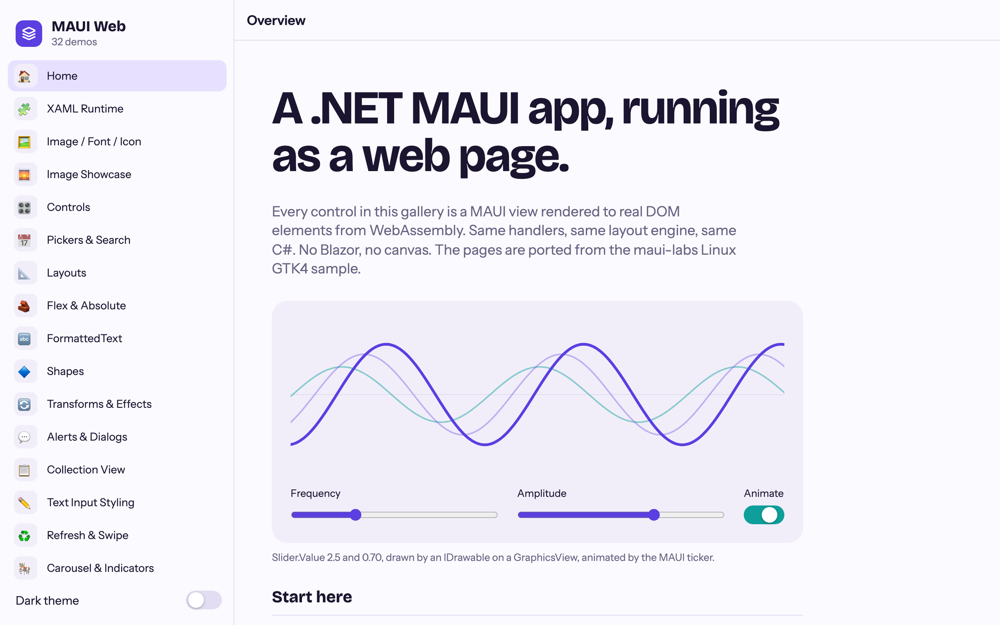
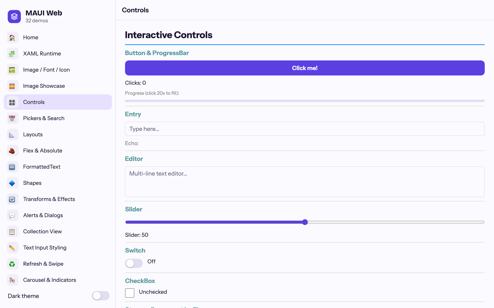
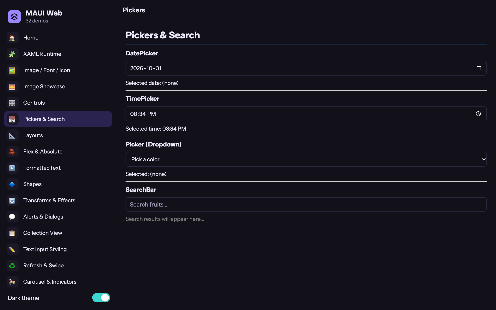
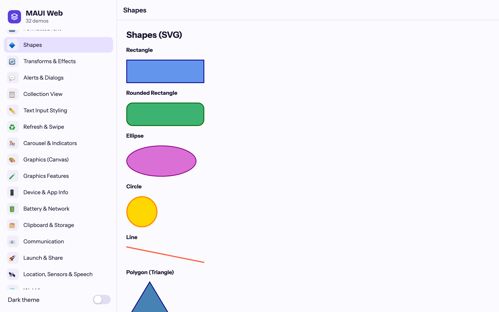
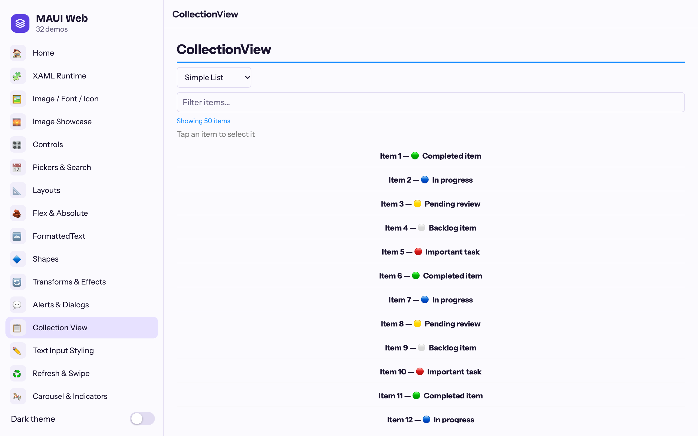
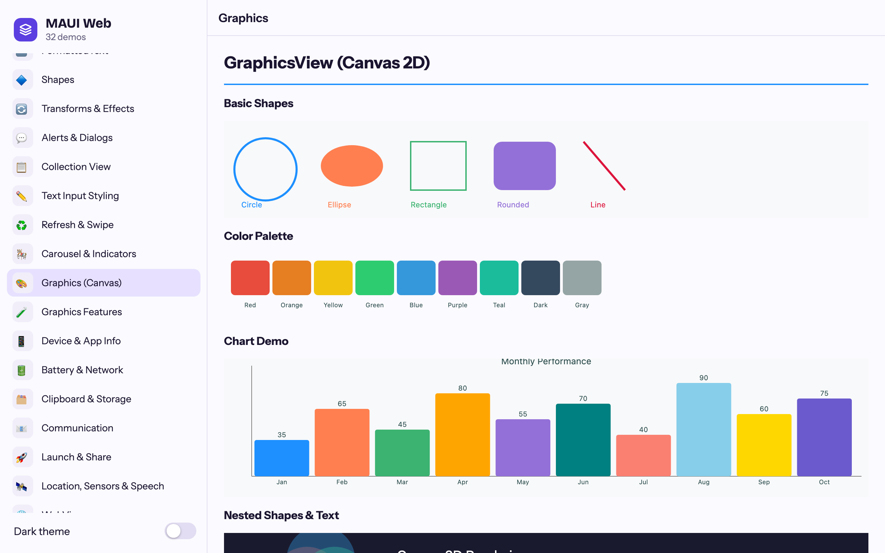
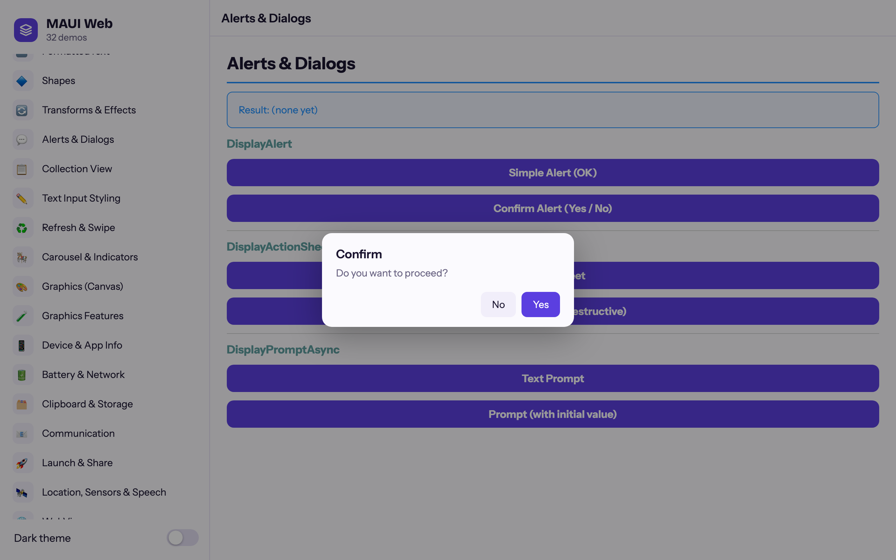

# Platform.Maui.Web

A .NET MAUI backend for the browser. Your MAUI app runs on WebAssembly and renders **real DOM
elements** — no Blazor, no Razor components, no canvas-drawn UI. It follows the structure and
lessons of the backends in [dotnet/maui-labs](https://github.com/dotnet/maui-labs/tree/main/platforms)
(Linux GTK4, macOS AppKit, WPF). Part of [shinyorg/mauiplatforms](../../readme.md).

> **Status:** experimental.



| | | |
|---|---|---|
|  |  |  |
|  |  |  |

| Package | Purpose |
|---|---|
| `Platform.Maui.Web` | Handlers, hosting, dispatcher, fonts, dialogs, theming, build targets |
| `Platform.Maui.Web.Essentials` | MAUI Essentials implemented with browser APIs |

## Getting started

An app is a `Microsoft.NET.Sdk.WebAssembly` project:

```xml
<Project Sdk="Microsoft.NET.Sdk.WebAssembly">
  <PropertyGroup>
    <TargetFramework>net10.0</TargetFramework>
    <OutputType>Exe</OutputType>
    <AllowUnsafeBlocks>true</AllowUnsafeBlocks>
    <ApplicationId>com.example.myapp</ApplicationId>
    <ApplicationTitle>My App</ApplicationTitle>
    <ApplicationDisplayVersion>1.0.0</ApplicationDisplayVersion>
  </PropertyGroup>
  <ItemGroup>
    <PackageReference Include="Platform.Maui.Web" Version="..." />
    <PackageReference Include="Platform.Maui.Web.Essentials" Version="..." />
  </ItemGroup>
</Project>
```

```csharp
// Program.cs
public class MyWebApp : WebMauiApplication
{
    protected override MauiApp CreateMauiApp() => MauiProgram.CreateMauiApp();
}

public static class Program
{
    public static Task Main() => new MyWebApp().RunAsync();
}

// MauiProgram.cs
var builder = MauiApp.CreateBuilder();
builder
    .UseMauiAppWeb<App>()          // instead of UseMauiApp<App>()
    .UseWebEssentials()
    .ConfigureFonts(f => f.AddFont("OpenSans-Regular.ttf", "OpenSansRegular"));
return builder.Build();
```

`wwwroot/index.html` loads `main.js`, which starts the runtime:

```js
import { dotnet } from './_framework/dotnet.js';
const { runMain } = await dotnet.create();
await runMain();
```

Then `dotnet run` (dev server with debugging) or `dotnet publish -c Release` (static files —
host `wwwroot/` anywhere). See [`samples/SampleWeb`](../../samples/SampleWeb): a 32-page gallery whose
pages are ported from the maui-labs [Linux GTK4 sample](https://github.com/dotnet/maui-labs/tree/main/platforms/Linux.Gtk4/samples),
in the same `FlyoutPage` + `CollectionView` menu structure (with emoji icon tiles), plus a live
GraphicsView hero, a docked sidebar on wide windows, an overlay menu on phones, and live
light/dark switching. It is themed with MAUI implicit styles and dynamic resources.

`MauiImage`, `MauiFont`, `MauiAsset` and `MauiIcon` items (default globs under `Resources/`) are
served from the site root. SVG images are served as SVG, and `Source="dotnet_bot.png"` resolves
to `dotnet_bot.svg` exactly as on the other platforms.

## How it works

- **One DOM element per handler.** Every platform view is a `WebElement` wrapping a `JSObject`.
  All DOM access goes through one JS module (`wwwroot/maui-web.js`) bound with `[JSImport]`
  ([`Interop/Dom.cs`](../../src/Platform.Maui.Web/Interop/Dom.cs)).
- **MAUI does the layout.** Elements are absolutely positioned; MAUI's cross-platform layout
  managers compute every frame, so Grid, FlexLayout, AbsoluteLayout and custom layouts behave as
  they do on other platforms. Leaf controls are measured synchronously in the DOM (the browser
  runtime is single-threaded, so that's safe), with results cached per handler and invalidated
  on property changes and font loads.
- **One layout pass per frame.** Measure invalidations are coalesced into a single
  `requestAnimationFrame` pass per window (`WebLayoutScheduler`); the window is driven by a
  `ResizeObserver`.
- **The JS event loop is the UI thread.** `WebDispatcher` queues with a `MessageChannel`,
  timers map to `setTimeout`/`setInterval`, and animations tick on `requestAnimationFrame`
  (honoring `prefers-reduced-motion`).
- **Native where the browser has it.** Inputs are `<input>`/`<textarea>`/`<select>`, dialogs are
  `<dialog>`, WebView is an `<iframe>`, shapes and Border strokes are SVG, GraphicsView is a 2D
  canvas fed by a recorded command buffer (one interop call per draw).
- **Fonts.** `ConfigureFonts` registrations load through the CSS Font Loading API. Variable fonts
  are detected (by their `fvar` table) and registered with their full weight range, and
  `FontImageSource` glyphs wait for pending fonts before rasterizing.
- **Measurement ignores transforms.** Sizes come from the element's used (computed) size, so
  text measured inside an animating or scaled container isn't measured short.
- **Theme.** Light/dark follows `prefers-color-scheme`; `Application.UserAppTheme` overrides it.
  Colors are CSS custom properties in `maui-web.css`, so the default look is easy to restyle.

## Lessons from maui-labs, applied

| Lesson (maui-labs) | Here |
|---|---|
| Essentials static `Default` facades need the internal `SetDefault` ([#34100](https://github.com/dotnet/maui/issues/34100), labs #573) | `EssentialsInitializer` sets every registered facade at `Build()` |
| `AppInfo` is read by Controls even without Essentials | Core registers `WebAppInfo` and sets `AppInfo.Current` in `UseMauiAppWeb` |
| `IAlertManagerSubscription` is internal and moved in MAUI 10.0.70 ([#34104](https://github.com/dotnet/maui/issues/34104), labs #575) | `DispatchProxy` registered in DI; both interface locations supported; survives trimming |
| AlertManager only subscribes when the platform asks | `WindowHandler.MapContent` triggers the subscription |
| Controls registers concrete Shape types | Each shape type is registered, not the `Shape` base |
| Don't fake security (labs #717) | `SecureStorage` throws `PlatformNotSupportedException`; unsupported features throw `FeatureNotSupportedException` |
| Version tracking must not consume first-launch state at startup (labs #573) | Deferred until first use |
| Async UI continuations must stay on the UI thread (labs #577) | Single-threaded runtime: continuations run on the JS event loop |
| Window titles are owned by `Window.Title` (labs #583) | `document.title` follows `Window.Title` only |
| Template/package versions drift (labs #534, #536) | MAUI version pinned in `Directory.Build.props` |
| Resizetizer has no extension points ([#34222](https://github.com/dotnet/maui/issues/34222)) | `buildTransitive` targets deploy resources as static web assets; SVG needs no rasterizing |
| Layout views re-measure at their arranged size before arranging children (iOS `MauiView.LayoutSubviews`) | `LayoutHandler`/`ContentViewHandler` re-measure when the frame differs from the last measure; otherwise max-width or re-aligned layouts arrange children at stale sizes |
| Controls registers stub handlers for many types, interfaces included | A unit test resolves every registered type after `UseMauiAppWeb` and fails if any still maps to a MAUI stub (it caught `IContentView`/`ContentPresenter`, plain `Page`, `HybridWebView` and menu items) |
| FlyoutPage decides split mode and rejects `IsPresented` changes that disagree | The handler follows `ShouldShowSplitMode`; apps choose `Split`/`Popover` for responsiveness |
| Async navigation failures vanish inside MAUI tasks | NavigationPage navigation errors are written to the console before rethrowing |
| Gesture events are raised through internal `Send*` methods | Reflection with `DynamicDependency` for Tap/Pointer; public controller interfaces for Pan |

## What's supported

**Pages & navigation:** ContentPage, NavigationPage (toolbar items, back button, bar colors),
TabbedPage (top tabs on wide viewports, bottom on phones), FlyoutPage (docked when split, otherwise
an overlay with a dismissing backdrop), Shell (flyout with header/footer/content, items, routes, `GoToAsync`, pushed pages, top
and bottom tabs, back button behavior), modal pages (full-window, or centered dialogs sized explicitly or to their content via
`WebPage.SetModalPresentationStyle`, mirroring the GTK backend's `GtkPage`), DisplayAlert /
DisplayActionSheet / DisplayPromptAsync.

**Controls:** Label (FormattedText, HTML, line breaks, MaxLines, decorations, transforms),
Button, ImageButton, Entry, Editor (auto-size), SearchBar, CheckBox, Switch, RadioButton, Slider, Stepper, ProgressBar, ActivityIndicator, Picker, DatePicker, TimePicker,
Image (file, URI, stream, font glyph), BoxView, Rectangle/Ellipse/Line/Path/Polygon/Polyline,
Border, Frame, ScrollView (ScrollToAsync, Scrolled), CollectionView (templates, selectors,
grouping, header/footer, empty view, linear/grid, selection + `Selected` visual state, scroll
events, RemainingItemsThreshold, ScrollTo), CarouselView + IndicatorView, GraphicsView,
WebView, RefreshView, SwipeView (content only), ContentView/ControlTemplate, all layouts.

**Common view properties:** background (solid/gradient), opacity, visibility, IsEnabled,
shadow, clip (any geometry via `clip-path`), transforms and anchors, z-index, flow direction,
input transparency, tooltips, semantics (`aria-*`), AutomationId (`data-automation-id`),
focus, VisualStateManager (PointerOver, Focused, Disabled, Selected).

**Gestures:** Tap (taps required, primary/secondary), Pan, Swipe, Pointer.

**Essentials** (`UseWebEssentials()`):

| Supported | Unsupported (throws / `IsSupported == false`) |
|---|---|
| AppInfo, DeviceInfo, DeviceDisplay (incl. KeepScreenOn via Wake Lock), Preferences (localStorage), FileSystem (in-memory VFS + package files over HTTP), VersionTracking, Connectivity, Battery, Clipboard, Browser, Launcher, Share (Web Share API, with fallbacks), Map, Email/PhoneDialer/Sms (URI schemes), Geolocation, Accelerometer, Gyroscope, Compass, OrientationSensor, Magnetometer (Generic Sensor API), TextToSpeech, Vibration, HapticFeedback, FilePicker, MediaPicker, Contacts.PickContactAsync (Contact Picker API), SemanticScreenReader | SecureStorage, Barometer, Screenshot, Flashlight, Geocoding, AppActions, Contacts.GetAllAsync, WebAuthenticator (not registered) |

Browser rules apply: file/media pickers, clipboard reads, sharing and motion-sensor permission
prompts (iOS) must start from a user gesture. FileSystem directories live in memory and are lost
on reload. FilePicker types need a `WebDevicePlatform.Web` entry (`WebFilePickerFileTypes`
provides the common ones).

## XAML and existing MAUI apps

XAML needs nothing web-specific. The `Microsoft.Maui.Controls` package's build assets collect
`*.xaml` as `MauiXaml`, compile it, and add MAUI's implicit usings to any project with
`ImplicitUsings` enabled, `UseMaui` or not. This is the same arrangement the
[maui-labs](https://github.com/dotnet/maui-labs) GTK4 backend documents. Verified with both compiled
inflators, in Debug and in trimmed Release publishes: `SourceGen` (the MAUI 10 template default,
recommended) and `XamlC`. The `Runtime` inflator hasn't been tested.

Verified on the stock `dotnet new maui` template (`App.xaml` with merged `Colors.xaml` and
`Styles.xaml`, `AppShell.xaml`, `MainPage.xaml`). Also verified with a page that uses compiled
`x:DataType` bindings with `StringFormat` and converters, commands and `ObservableCollection`,
`CollectionView` templates and selection, `AppThemeBinding`, `OnPlatform` and `OnIdiom`, property
triggers and `DataTrigger`, `VisualStateManager` with `StateTrigger`, a XAML `ContentView` with
bindable properties, and pages and resource dictionaries from a referenced class library.

### Adding a web head to an existing app

Keep the app project as it is and add a web project beside it that links the shared XAML and C#.
The platform folders and the app's `MauiProgram.cs` stay behind. Shiny's `Sample.Linux` and the
maui-labs Linux heads follow the same pattern.

```xml
<Project Sdk="Microsoft.NET.Sdk.WebAssembly">
  <PropertyGroup>
    <TargetFramework>net10.0</TargetFramework>
    <OutputType>Exe</OutputType>
    <ImplicitUsings>enable</ImplicitUsings>
    <Nullable>enable</Nullable>
    <AllowUnsafeBlocks>true</AllowUnsafeBlocks>
    <RootNamespace>MyApp</RootNamespace>
    <MauiXamlInflator>SourceGen</MauiXamlInflator>
    <!-- Resources come from the app project, below. -->
    <EnableDefaultMauiResourceItems>false</EnableDefaultMauiResourceItems>
  </PropertyGroup>
  <ItemGroup>
    <Compile Include="..\MyApp\**\*.cs" Exclude="..\MyApp\Platforms\**;..\MyApp\MauiProgram.cs;..\MyApp\obj\**;..\MyApp\bin\**" Link="%(RecursiveDir)%(Filename)%(Extension)" />
    <MauiXaml Include="..\MyApp\**\*.xaml" Exclude="..\MyApp\Platforms\**;..\MyApp\obj\**;..\MyApp\bin\**" Link="%(RecursiveDir)%(Filename)%(Extension)" />
    <MauiImage Include="..\MyApp\Resources\Images\*" />
    <MauiFont Include="..\MyApp\Resources\Fonts\*" />
    <MauiAsset Include="..\MyApp\Resources\Raw\**" LogicalName="%(RecursiveDir)%(Filename)%(Extension)" />
    <MauiIcon Include="..\MyApp\Resources\AppIcon\appicon.svg" />
  </ItemGroup>
  <ItemGroup>
    <PackageReference Include="Platform.Maui.Web" Version="*-*" />
    <PackageReference Include="Platform.Maui.Web.Essentials" Version="*-*" />
  </ItemGroup>
</Project>
```

Then add the web project's own `wwwroot/index.html`, `wwwroot/main.js`, `Program.cs` and
`MauiProgram.cs` (steps 2–5 of the [setup](../../readme.md#setting-up-a-web-app)), with
`UseMauiAppWeb<App>()` and the same `ConfigureFonts` as the app. If the app code uses
`#if ANDROID`/`#if IOS` blocks, the web head builds with neither defined; `WEB` and `BROWSER` are
defined instead.

**Alternative: a shared UI library.** Move pages, views, view models and resource dictionaries
into a class library with `UseMaui` that also targets plain `net10.0`, for example
`<TargetFrameworks>net10.0;net10.0-android;net10.0-ios</TargetFrameworks>`. Both the app and the
web head reference it; the web head consumes the `net10.0` build. Reference XAML types from
another assembly with `xmlns:ui="clr-namespace:MyApp.UI;assembly=MyApp.UI"`. Use `$(MauiVersion)`
for its `Microsoft.Maui.Controls` reference, so the app doesn't see a package downgrade.

**Things to know:**
- `OnPlatform` matches `Web`. The markup-extension form only has fixed platform properties, so use
  the element form: `<OnPlatform x:TypeArguments="x:String"><On Platform="Web" Value="…" /></OnPlatform>`.
- `OnIdiom` follows `DeviceInfo.Idiom`: `Desktop` with a fine pointer (mouse), otherwise `Phone` or
  `Tablet` by the screen's short side (600 px).
- Trimming: prefer compiled bindings (`x:DataType`). MAUI warns that the `{OnIdiom}` markup
  extension isn't trim-safe (use `OnIdiom<T>`), and turns `[QueryProperty]` off in trimmed builds
  (use `IQueryAttributable`). Both are MAUI rules that apply on every platform.

## Known limitations

- **CollectionView is not virtualized** — every item is realized. Page large sources with
  `RemainingItemsThreshold`.
- **ListView and TableView** (obsolete) and **HybridWebView** render a placeholder; MenuBar and
  context menus aren't rendered.
- **Not yet:** pull-to-refresh and swipe-item gestures, PinchGestureRecognizer, drag & drop,
  MenuBar/ContextFlyout, CarouselView `Loop`, BlazorWebView, `Application.OpenWindow`, browser
  history integration for navigation.
- **GraphicsView images** draw (the browser decodes them), but MAUI's `net10.0` `PlatformImage`
  can't decode, so its `Width`/`Height` are wrong; code that sizes drawing from them misplaces it.
- **`Loaded` fires before the first layout pass** (sizes are still -1). That's MAUI Controls' own
  behaviour on platform-agnostic targets (GTK4 matches); use `SizeChanged` for size-dependent work.
- **WebView** script evaluation and history only work for same-origin content.
- **Threads:** the backend targets the default single-threaded WebAssembly runtime.

## Building and testing

From the repository root:

```bash
dotnet build "MAUI Platforms.slnx"
dotnet test tests/Platform.Maui.Web.Tests                      # unit tests (CSS conversion, canvas encoding, ...)

dotnet publish samples/SampleWeb -c Release -o artifacts/SampleWeb
node tests/browser/smoke.mjs artifacts/SampleWeb/wwwroot   # quick end-to-end check, no npm (CHROME=path to override)

cd tests/playwright                                     # full end-to-end suite (Chromium, WebKit, phone)
npm ci && npx playwright install chromium webkit
npx playwright test                                     # --project=chromium, --ui, -g "Shell" ...
npm run screenshots                                     # regenerate docs/web/images for the READMEs
```

The Playwright suite drives the published, trimmed sample (trimming is where the backend most often
breaks), serves it itself (also under `/sub/` to cover subpath hosting), and fails any test whose
page logged a console error. `SAMPLE_WWWROOT` points it at another publish folder. Specs cover
startup and static assets, every gallery page, control input, dialogs, NavigationPage / TabbedPage /
FlyoutPage / Shell / modals, CollectionView, graphics, theming, narrow screens, Essentials (with
geolocation, offline and the clipboard faked by Playwright) and accessibility roles.

```
src/Platform.Maui.Web/                 Microsoft.Maui.Platform.Web
  Handlers/              one handler (or family) per file; WebElementHandler is the base
  Platform/              application, window, dispatcher, ticker, fonts, dialogs, theme, canvas
  Hosting/               UseMauiAppWeb<TApp>()
  Interop/               [JSImport] bindings
  wwwroot/               maui-web.js / maui-web.css (static web assets)
  buildTransitive/       Platform.Maui.Web.targets: MauiImage/MauiFont/MauiAsset/MauiIcon deployment, app metadata
src/Platform.Maui.Essentials.Web/      Microsoft.Maui.Essentials.Web
samples/SampleWeb/      Shell gallery app
tests/Platform.Maui.Web.Tests/         xUnit
tests/browser/           CDP smoke test (no dependencies)
tests/playwright/        Playwright end-to-end suite
```

The library projects use `Microsoft.NET.Sdk.Razor` **only** for its static web asset pipeline,
which is how `maui-web.js` reaches consuming apps under `_content/`. No Razor or Blazor code is
compiled or referenced.
