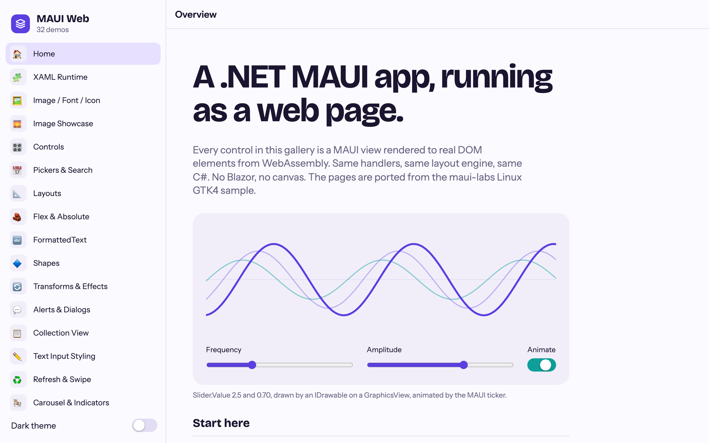
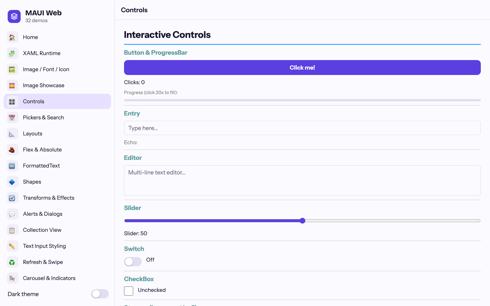
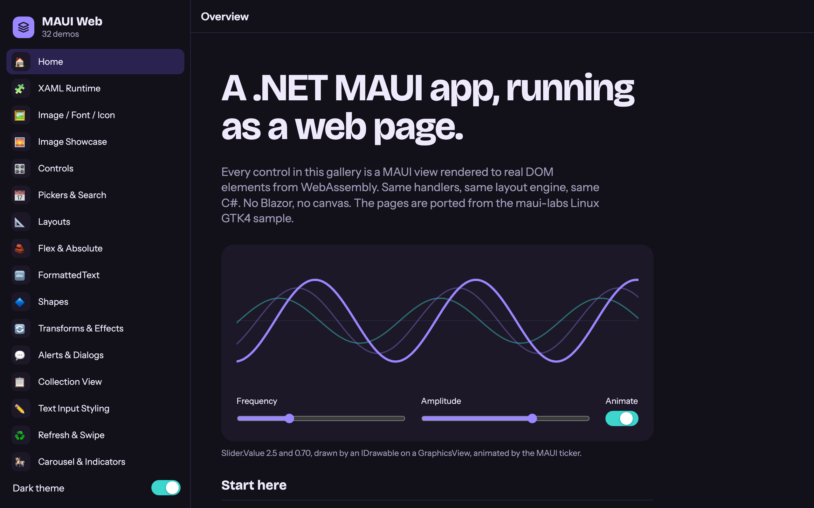
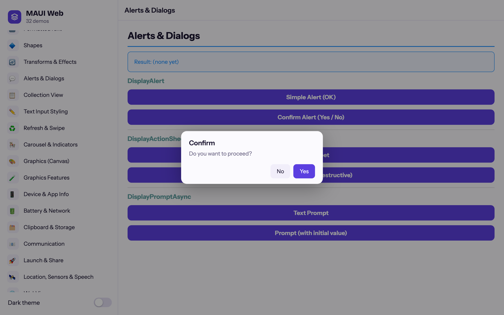
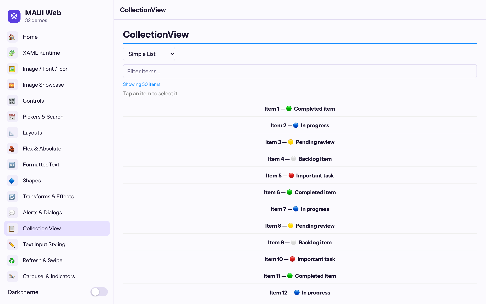
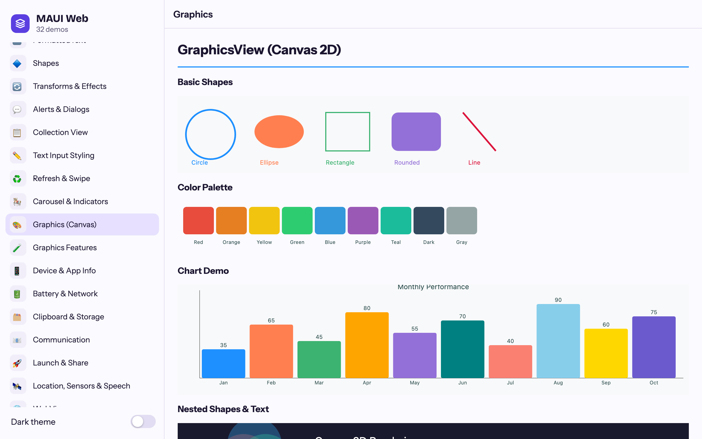
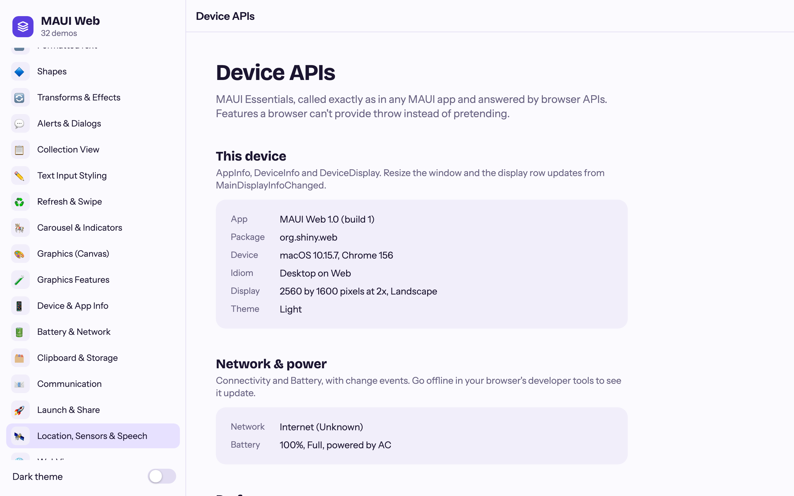
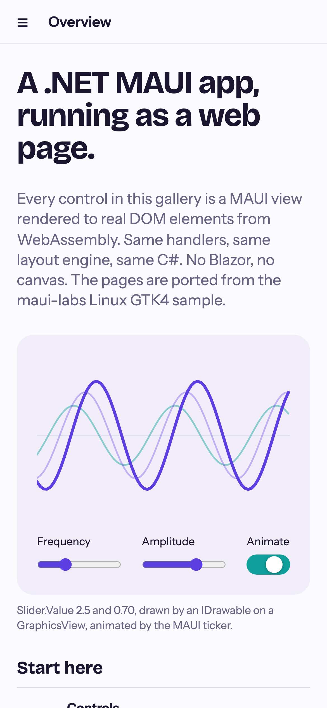
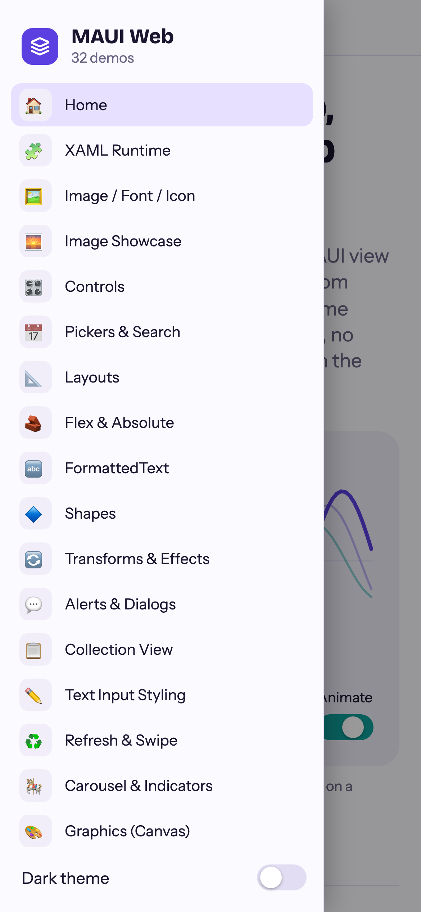
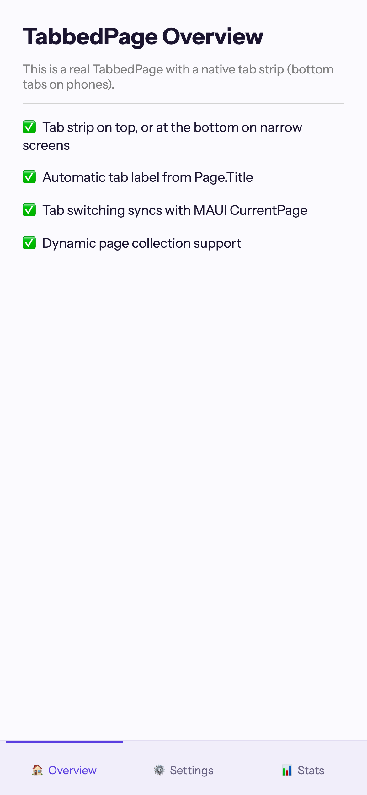

# .NET MAUI Backends for Apple TV & the Web

[](https://www.nuget.org/packages/Platform.Maui.TvOS/)
[](https://www.nuget.org/packages/Platform.Maui.Essentials.TvOS/)
[](https://www.nuget.org/packages/Platform.Maui.Web/)
[](https://www.nuget.org/packages/Platform.Maui.Web.Essentials/)

Custom .NET MAUI backends for platforms MAUI doesn't officially support: **Apple TV** (tvOS via UIKit) and
the **web** (WebAssembly, rendering real DOM elements, without Blazor).

**▶ Try the web sample live: [shinyorg.github.io/mauiplatforms](https://shinyorg.github.io/mauiplatforms/)**: the MAUI
gallery plus a Shiny Controls tab, running entirely in your browser.

Both backends use the platform-agnostic MAUI NuGet packages (`net10.0` fallback assemblies) and provide custom
handler implementations that bridge MAUI's layout/rendering system to the native UI of each platform.

> **macOS has moved.** The macOS (AppKit) backend that started here was merged into
> [dotnet/maui-labs](https://github.com/dotnet/maui-labs) and continues there as
> [`platforms/MacOS`](https://github.com/dotnet/maui-labs/tree/main/platforms/MacOS). Use that for new macOS work.
> The code and docs from this repository are kept, unbuilt, in [`archive/macos`](archive/macos).

https://github.com/user-attachments/assets/035de5fa-bda6-49d1-98f6-41cd4d6ff559

## Web (WebAssembly)

`Platform.Maui.Web` runs a MAUI app in the browser on WebAssembly. Every control is a real DOM element
(`<button>`, `<input>`, `<dialog>`, SVG for shapes, a 2D canvas for GraphicsView), positioned by MAUI's own
cross-platform layout engine. No Blazor, no Razor components, no canvas-drawn UI.



| Controls | Dark theme | Dialogs |
|---|---|---|
|  |  |  |
| **CollectionView** | **GraphicsView** | **Essentials** |
|  |  |  |

On a phone the flyout becomes a popover and tabs move to the bottom:

<p>
  
  
  
</p>

### Setting up a web app

You need the [.NET 10 SDK](https://dotnet.microsoft.com/download/dotnet/10.0). No workload is required
(`wasm-tools` is only needed if you opt into AOT compilation). Any modern browser runs the result.

#### 1. Create the project

Create a folder with this project file (`MyApp.csproj`):

```xml
<Project Sdk="Microsoft.NET.Sdk.WebAssembly">
  <PropertyGroup>
    <TargetFramework>net10.0</TargetFramework>
    <OutputType>Exe</OutputType>
    <Nullable>enable</Nullable>
    <ImplicitUsings>enable</ImplicitUsings>
    <!-- Required by the [JSImport] interop the backend generates. -->
    <AllowUnsafeBlocks>true</AllowUnsafeBlocks>

    <!-- Read at runtime by AppInfo (Name, PackageName, VersionString, BuildString). -->
    <ApplicationTitle>My App</ApplicationTitle>
    <ApplicationId>com.example.myapp</ApplicationId>
    <ApplicationDisplayVersion>1.0</ApplicationDisplayVersion>
    <ApplicationVersion>1</ApplicationVersion>
  </PropertyGroup>

  <ItemGroup>
    <!-- The packages are prereleases, so float on prerelease versions (or pin an exact one). -->
    <PackageReference Include="Platform.Maui.Web" Version="*-*" />
    <PackageReference Include="Platform.Maui.Web.Essentials" Version="*-*" />
  </ItemGroup>
</Project>
```

The SDK is `Microsoft.NET.Sdk.WebAssembly`, not `Microsoft.NET.Sdk.BlazorWebAssembly`: there is no Blazor.
`Microsoft.Maui.Controls` comes in through the `Platform.Maui.Web` package.

> **Building from this repository instead of NuGet?** Replace the two package references with project
> references, and import the backend's build targets yourself (packages do this automatically):
>
> ```xml
> <ItemGroup>
>   <ProjectReference Include="path/to/mauiplatforms/src/Platform.Maui.Web/Platform.Maui.Web.csproj" />
>   <ProjectReference Include="path/to/mauiplatforms/src/Platform.Maui.Essentials.Web/Platform.Maui.Essentials.Web.csproj" />
> </ItemGroup>
> <Import Project="path/to/mauiplatforms/src/Platform.Maui.Web/buildTransitive/Platform.Maui.Web.targets" />
> ```

#### 2. Add the host page (`wwwroot/index.html`)

```html
<!DOCTYPE html>
<html lang="en">
<head>
    <meta charset="utf-8" />
    <meta name="viewport" content="width=device-width, initial-scale=1, viewport-fit=cover" />
    <title>My App</title>
    <link rel="icon" href="favicon.svg" />
    <script type="module" src="./main.js"></script>
</head>
<body>
    <div id="loading">Loading…</div>
</body>
</html>
```

The app fills the whole page. To host it inside part of an existing page instead, override
`HostElementSelector` in your `WebMauiApplication` (step 4) with a CSS selector such as `"#app"`.

#### 3. Start .NET from JavaScript (`wwwroot/main.js`)

```js
import { dotnet } from './_framework/dotnet.js';

const { runMain } = await dotnet.create();
await runMain();
document.getElementById('loading')?.remove();
```

Use `runMain()`, not `dotnet.run()`: `run()` exits the runtime when `Main` returns, which would stop the app.

#### 4. Add the entry point (`Program.cs`)

```csharp
using Microsoft.Maui.Hosting;
using Microsoft.Maui.Platform.Web;

namespace MyApp;

public class MyWebApp : WebMauiApplication
{
    protected override MauiApp CreateMauiApp() => MauiProgram.CreateMauiApp();
}

public static class Program
{
    public static Task Main() => new MyWebApp().RunAsync();
}
```

#### 5. Configure MAUI (`MauiProgram.cs`)

```csharp
using Microsoft.Maui.Essentials.Web;
using Microsoft.Maui.Hosting;
using Microsoft.Maui.Platform.Web.Hosting;

namespace MyApp;

public static class MauiProgram
{
    public static MauiApp CreateMauiApp()
    {
        var builder = MauiApp.CreateBuilder();
        builder
            .UseMauiAppWeb<App>()       // instead of UseMauiApp<App>()
            .UseWebEssentials()         // optional: AppInfo, Preferences, Geolocation, ...
            .ConfigureFonts(fonts => fonts.AddFont("OpenSans-Regular.ttf", "OpenSansRegular")); // file in Resources/Fonts
        return builder.Build();
    }
}
```

#### 6. Write the app as usual (`App.cs`)

```csharp
using Microsoft.Maui.Controls;

namespace MyApp;

public class App : Application
{
    protected override Window CreateWindow(Microsoft.Maui.IActivationState? activationState)
        => new(new ContentPage
        {
            Content = new VerticalStackLayout
            {
                Padding = 24,
                Spacing = 12,
                Children =
                {
                    new Label { Text = "Hello from .NET MAUI on the web!", FontSize = 24 },
                    new Image { Source = "dotnet_bot.png", HeightRequest = 160 },
                    new Button { Text = "Click me" },
                },
            },
        });
}
```

Everything else is standard MAUI: XAML or C# pages, `Shell`, `NavigationPage`, bindings, styles, `DisplayAlertAsync`.

> **Already have a MAUI app?** Add a web project beside it that links the app's XAML and C#
> (leaving `Platforms/` and `MauiProgram.cs` behind), or move the UI into a shared library that also
> targets plain `net10.0`. XAML needs no web-specific setup. See
> [XAML and existing MAUI apps](docs/web/readme.md#xaml-and-existing-maui-apps) for the project file.

#### 7. Add resources (optional)

The same folders as a MAUI single project are picked up automatically and served from the site root:

| Folder | Item | Notes |
|---|---|---|
| `Resources/Images/` | `MauiImage` | SVGs are served as SVG; `Source="name.png"` finds `name.svg` |
| `Resources/Fonts/` | `MauiFont` | Register with `ConfigureFonts`; variable fonts get their full weight range |
| `Resources/Raw/` | `MauiAsset` | Read with `FileSystem.OpenAppPackageFileAsync("file.txt")` |
| `Resources/AppIcon/appicon.svg` | `MauiIcon` | Served as `favicon.svg` (linked in step 2) |

Set `<EnableDefaultMauiResourceItems>false</EnableDefaultMauiResourceItems>` to declare these items yourself.

#### 8. Run it

```bash
dotnet run
```

Open the `App url` it prints. The dev server also prints a debugging URL for browser-based .NET debugging.

#### 9. Publish and host

```bash
dotnet publish -c Release -o publish
```

Upload `publish/wwwroot` to any static host: GitHub Pages, Azure Static Web Apps, Netlify, S3/CloudFront, nginx.
Things to check on the host:

- **`.wasm` must be served as `application/wasm`.** Most hosts already do this.
- **Compression:** the publish output includes `.br` and `.gz` copies of every file. Serve them with the
  matching `Content-Encoding` when your host supports it; otherwise the uncompressed files are used.
- **Hosting under a subpath** (for example `https://example.com/myapp/`): add `<base href="/myapp/" />` to
  `<head>` in `index.html`. The backend resolves its scripts and your resources against the document's base URL.
- **Trimming:** Release builds are trimmed. String-path bindings (`SetBinding(..., "Name")`) and
  `QueryPropertyAttribute` rely on reflection; prefer compiled bindings (`SetBinding(..., static (Item i) => i.Name)`),
  or keep your app assembly whole with `<ItemGroup><TrimmerRootAssembly Include="MyApp" /></ItemGroup>`.

#### Theming the built-in chrome

Your MAUI styles style your views. The pieces the backend draws itself (navigation bar, tab bar, flyout,
dialogs, native inputs) use CSS custom properties you can override in `index.html`:

```html
<style>
    html:root { --maui-accent: #0E7C66; --maui-font: "Inter", system-ui, sans-serif; }
</style>
```

See `--maui-*` in [`maui-web.css`](src/Platform.Maui.Web/wwwroot/maui-web.css) for the full list, including
dark-mode values.

For how the backend works (rendering, layout and measurement, threading), the lessons carried over from the
maui-labs backends, and known limitations, see **[docs/web](docs/web/readme.md)**.

[`samples/SampleWeb`](samples/SampleWeb) is a 32-page gallery whose pages are ported from the maui-labs
[Linux GTK4 sample](https://github.com/dotnet/maui-labs/tree/main/platforms/Linux.Gtk4/samples).

## Project Structure

```
src/
  Platform.Maui.TvOS/               # tvOS backend library (net10.0-tvos)
  Platform.Maui.Essentials.TvOS/    # tvOS Essentials library
  Platform.Maui.Web/                # Web backend library (net10.0, browser/WebAssembly)
  Platform.Maui.Essentials.Web/     # Web Essentials library
  Platform.Maui.Web.SkiaSharp/      # Web handler for SkiaSharp's SKCanvasView (Skia on WebAssembly)
  Shiny.Maui.Controls.Camera.Web/   # Web handler for the Shiny CameraView (getUserMedia)
  Shiny.Maui.Controls.MediaElement.Web/ # Web backend for the Shiny MediaElement and VideoText (<video>)
samples/
  Sample/                           # Shared sample code (Pages, Platforms/)
  SampleTv/                         # tvOS sample app (a streaming-style catalog driven by the Siri Remote)
  SampleWeb/                        # Web gallery app (MAUI and Shiny Controls tabs)
tests/
  Platform.Maui.Web.Tests/          # Web unit tests (xUnit)
  browser/                          # Web end-to-end smoke test (headless Chrome)
  playwright/                       # Web end-to-end suite (Playwright: Chromium, WebKit, phone)
docs/
  web/                              # Web backend guide
archive/
  macos/                            # The former macOS backend (merged into dotnet/maui-labs)
```

> **Note:** `Sample/Sample.csproj` multitargets `net10.0-tvos` and `net10.0-macos` (now referencing the archived
> macOS projects) and is **not yet working**. Use `SampleTv` and `SampleWeb`.

## Handlers Implemented

### Controls

| Control | tvOS (UIKit) | Web (DOM) |
|---------|-------------|-----------|
| Label | UILabel | `<div>` with spans (FormattedText, HTML) |
| Button | UIButton | `<button>` |
| ImageButton | — | `<button>` + `` |
| Entry | UITextField | `<input>` |
| Editor | — | `<textarea>` (auto-size) |
| Picker | UIButton + UIAlertController | `<select>` |
| Slider | Custom TvOSSliderView | `<input type="range">` |
| Stepper | — | Button pair |
| Switch | UIButton (toggle) | Styled checkbox, `role="switch"` |
| CheckBox | — | `<input type="checkbox">` |
| RadioButton | — | `<input type="radio">`, or its ControlTemplate |
| SearchBar | Custom TvOSSearchBarView | `<input type="search">` |
| ActivityIndicator | UIActivityIndicatorView | CSS spinner |
| ProgressBar | UIProgressView | `<progress>` |
| Image | UIImageView | `` (file, URI, stream, font glyph; SVG served as SVG) |
| DatePicker | — | `<input type="date">` |
| TimePicker | — | `<input type="time">` |
| WebView | — | `<iframe>` |
| MapView | MKMapView (display-only) | — |

### Pages & Navigation

| Page | tvOS | Web |
|------|------|-----|
| ContentPage | ✅ | ✅ |
| NavigationPage | ✅ Stack navigation | ✅ Navigation bar, back button, toolbar items |
| TabbedPage | ✅ Custom tab bar | ✅ Tab strip (bottom on phone widths) |
| FlyoutPage | — | ✅ Docked when split, otherwise an overlay |
| Shell | — | ✅ Flyout, tabs, routes, push/pop |
| Modal pages | — | ✅ Full-window or dialog (`WebPage.SetModalPresentationStyle`) |

### Collections

| Control | tvOS | Web |
|---------|------|-----|
| CollectionView | ✅ Virtualized UICollectionView: focusable items, selection, list/grid/horizontal layouts, EmptyView | ✅ Virtualized with view recycling: templates, grouping, selection, EmptyView, Header/Footer, list/grid layouts |
| CarouselView | ✅ Horizontal paging | ✅ Virtualized, CSS scroll snapping, `Loop` |
| ListView | — | — (placeholder; use CollectionView) |
| TableView | — | — (placeholder) |
| IndicatorView | — | ✅ |
| RefreshView | — | ✅ Spinner (no pull gesture) |
| SwipeView | — | Content only |

### Layouts

All layouts work on both platforms: `VerticalStackLayout`, `HorizontalStackLayout`, `Grid`, `FlexLayout`, `AbsoluteLayout`, `ScrollView`, `ContentView`, `Border`, `Frame`.

### Graphics & Shapes

| Feature | tvOS | Web |
|---------|------|-----|
| GraphicsView | — | ✅ Canvas 2D (paths, arcs, text, gradients, images); redraws at most once per frame, not while off screen |
| Shapes (Rectangle, Ellipse, Line, Polyline, Polygon, Path) | ✅ | ✅ SVG |
| Shadow | ✅ | ✅ `box-shadow` |
| Gradient Brushes (Linear, Radial) | ✅ Layouts, Border, pages (controls use the first stop) | ✅ CSS gradients |

### Gestures

| Gesture | tvOS | Web |
|---------|------|-----|
| Tap | ✅ Select on the remote (the view becomes focusable) | ✅ |
| Pan | — | ✅ |
| Swipe | — | ✅ |
| Pinch | — | — |
| Pointer (Hover) | — | ✅ |

### Infrastructure

| Component | tvOS | Web |
|-----------|------|-----|
| Application | NSObject | `WebMauiApplication` |
| Window | UIWindow + UIViewController | Full-viewport element, `ResizeObserver` |
| Dispatcher | GCD (DispatchQueue.MainQueue) | JS event loop (`MessageChannel`) |
| DispatcherTimer | NSTimer | `setTimeout` / `setInterval` |
| Dialogs (Alert, Confirm, Prompt) | ✅ UIAlertController | ✅ `<dialog>` |
| Font Management | ✅ | ✅ CSS Font Loading API (variable fonts) |
| Dark/Light Mode | ✅ | ✅ `prefers-color-scheme` and `UserAppTheme` |
| Animations | ✅ | ✅ `requestAnimationFrame` ticker |
| FormattedText / Spans | — | ✅ |
| InputTransparent | ✅ | ✅ `pointer-events` |
| Toolbar | — | ✅ ToolbarItems in the navigation bar |
| Window Resize Relayout | — | ✅ |
| XAML | — (C# pages) | ✅ XamlC and SourceGen inflators, including trimmed Release |

### Third-party control libraries

Controls built from standard MAUI views run unchanged; controls that ship their own platform
handlers only for iOS, Android or Windows need a web handler first. As a check, the core
[Shiny.Maui.Controls](https://github.com/shinyorg/controls) 2.3.1 package was run against the
backend unmodified: 71 of its 74 controls render and run without errors, from TableView, DataGrid,
the schedulers and Chat to dialogs, toasts, floating panels and walkthroughs. `CarouselGallery`,
`StaggeredGrid` and `VirtualizedGrid` use native recycler views and have no web handler. A few
features fall short: the `ImageEditor` canvas stays blank and `SignaturePad` exports an empty PNG
(both rely on platform image APIs plain `net10.0` lacks), the indeterminate `ProgressBar` doesn't
animate (it starts in `Loaded`, which fires before layout on `net10.0`), and DataGrid inline row
editing doesn't appear.

SampleWeb's Shiny Controls tab runs these against the published packages with no web handlers:
floating panels (bottom, top, dual and minimized-header sheets), ChatView, SignaturePad, the scheduler
(calendar, agenda, list), Gantt, `Shiny.Maui.Controls.Diagram`, `Shiny.Maui.Controls.MermaidDiagrams` and
ImageViewer, plus the Office viewers below. Two gaps come from the controls' `net10.0` build, not the
web backend: SignaturePad's PNG export returns an empty stream (drawing works), and ImageEditor can't show
an image, because MAUI's `net10.0` `PlatformImage` reads a PNG's size from its signature bytes.

#### SkiaSharp

`SkiaSharp.Views.Maui` ships its view handlers only for the native platforms, so `Platform.Maui.Web.SkiaSharp`
provides `SKCanvasView` for the web. Reference it next to `Platform.Maui.Web` and call `UseSkiaSharpWeb()`
**instead of** `UseSkiaSharp()`:

```csharp
builder
    .UseMauiAppWeb<App>()
    .UseSkiaSharpWeb();   // Platform.Maui.Web.SkiaSharp (namespace Microsoft.Maui.Platform.Web.Hosting)
```

Skia itself (`SkiaSharp.NativeAssets.WebAssembly`) is linked into the app's `dotnet.native.wasm`, so the app
needs the `wasm-tools` workload and every build relinks the native runtime. The package turns this on for you.

- **SKCanvasView** renders on WebAssembly into a raster surface at the device pixel ratio, and each frame
  is copied onto a `<canvas>` in one interop call. It supports `PaintSurface`, `InvalidateSurface`
  (at most one paint per animation frame, and none while the view is off screen), `CanvasSize`,
  `IgnorePixelScaling`, and `EnableTouchEvents` with `Touch` for mouse, touch and pen (pointer ids, buttons,
  pressure, wheel). A handled press captures the pointer and stops the browser from scrolling.
- Not supported yet: `SKGLView` (WebGL) and the `SKImageImageSource` family of image sources. Skia on the
  web has no system fonts; load typefaces with `SKTypeface.FromStream` (for example from a MauiAsset).

**Shiny Office controls.** `Shiny.Maui.Controls.Office` draws on `SKCanvasView`, so its viewers run on the
web with this package. Call `UseShinyOffice()` **before** `UseSkiaSharpWeb()` (it registers SkiaSharp's own
handlers, and the last registration wins), and register fonts with `OfficeFontRegistry.Default`, or every
document draws in Skia's monospace fallback. SampleWeb bundles Carlito and Caladea, the metric-compatible
Calibri and Cambria substitutes, as MauiAssets (`Pages/Shiny/Office/OfficeWebFonts.cs`). `SpreadsheetView`,
`DocumentView` and `SlideView` work. The editors (`DocumentEditorView`, `SlideEditorView`,
`NotebookEditorView`) don't yet: building their ribbon creates a MAUI `FilePickerFileType`, whose type
initializer throws on plain `net10.0`.

#### Shiny CameraView and MediaElement

`Shiny.Maui.Controls.Camera` and `Shiny.Maui.Controls.MediaElement` ship native handlers only, so this
repo provides their web backends as separate projects (not published to NuGet yet; SampleWeb references
them directly). Reference them next to `Platform.Maui.Web` and call the web registration **instead of**
`UseShinyCamera()` / `UseShinyMediaElement()`:

```csharp
builder
    .UseMauiAppWeb<App>()
    .UseShinyControls()
    .UseShinyCameraWeb()          // Shiny.Maui.Controls.Camera.Web
    .UseShinyMediaElementWeb();   // Shiny.Maui.Controls.MediaElement.Web (MediaElement + VideoText)
```

Their JavaScript ships as static web assets and loads on first use, so nothing goes in `index.html`.

- **CameraView** streams `getUserMedia` into a `<video>`. It supports picking the camera (`Facing`, `CameraId`),
  `IsActive`, zoom and torch where the browser exposes them, `ScaleMode`, `ShowPreview`, the built-in filters
  (as CSS filters, baked into stills), JPEG photos, and `MediaRecorder` video written to the wasm file
  system. Frame analyzers, flash, focus and drawn effects aren't supported, nor is the modal
  `IMediaService` flow. Browsers only allow the camera over HTTPS or on localhost.
- **MediaElement** plays through one `<video>` element that moves between the inline and fullscreen
  surfaces without re-buffering. It covers the transport bar, seeking, volume, speed, looping, aspect,
  buffering progress, picture-in-picture, a screen wake lock (`KeepScreenOn`) and Media Session metadata
  and controls. `Uri`, `Resource` (MauiAssets) and `File` sources work; what plays depends on the
  browser's codecs.
- **VideoText** gets its own web handler (`net10.0` VideoText otherwise falls back to a plain label):
  a looping, muted video shown through the letters, with the overlay, marquee, auto-fit and fonts
  drawn from the same SVG as Shiny's Blazor VideoText. Without an overlay the text is a CSS mask
  image, which browsers draw with system fonts only.

## Lifecycle Events

Both platforms fire standard `IWindow` lifecycle methods and support MAUI's `ConfigureLifecycleEvents` builder pattern.

### IWindow Lifecycle

| IWindow Method | tvOS Trigger | Web Trigger |
|---|---|---|
| `Created()` | App launch | App start |
| `Activated()` | App becomes active | App start, tab shown |
| `Deactivated()` | App resigns activation | Tab hidden |
| `Stopped()` | App enters background | Tab hidden |
| `Resumed()` | App enters foreground | Tab shown |
| `Destroying()` | App terminating | `Application.CloseWindow` |

### Platform-Specific Lifecycle Events

```csharp
builder.ConfigureLifecycleEvents(events =>
{
    events.AddWeb(web => web
        .OnMauiApplicationCreated(app => { })
        .OnWindowCreated(window => { /* WebWindow */ })
        .OnVisibilityChanged(visible => { })
    );
});
```

## Essentials

Platform-specific implementations of MAUI Essentials APIs.

### Setup

```csharp
// tvOS
EssentialsExtensions.UseTvOSEssentials();

// Web (MauiProgram.cs)
builder.UseWebEssentials();
```

Then use the standard MAUI Essentials APIs:
```csharp
var appName = AppInfo.Name;
var version = AppInfo.VersionString;
var theme = AppInfo.RequestedTheme;
var model = DeviceInfo.Model;
```

### Supported APIs

| API | tvOS | Web | Notes |
|-----|------|-----|-------|
| AppInfo | ✅ | ✅ | Package name, version, build, theme, layout direction |
| DeviceInfo | ✅ | ✅ | Model, manufacturer, device name, OS version, platform, idiom |
| Connectivity | ✅ | ✅ | Network access status, connection profiles, change events |
| Battery | — | ✅ | Web: Battery API where the browser has it |
| DeviceDisplay | ✅ | ✅ | Web: also KeepScreenOn via the Wake Lock API |
| FileSystem | ✅ | ✅ | Web: in-memory directories; app package files fetched from the site |
| Preferences | ✅ | ✅ | tvOS: NSUserDefaults, Web: localStorage |
| SecureStorage | ✅ | ❌ | Web throws `PlatformNotSupportedException`: a browser has nowhere safe to keep secrets |
| FilePicker | — | ✅ | |
| MediaPicker | — | ✅ | |
| TextToSpeech | ✅ | ✅ | tvOS: AVSpeechSynthesizer, Web: `speechSynthesis` |
| Clipboard | ✅ | ✅ | tvOS: in-process, Web: async Clipboard API |
| Browser | — | ✅ | |
| Share | — | ✅ | Web Share API, with fallbacks |
| Launcher | — | ✅ | |
| Map, Email, PhoneDialer, Sms | — | ✅ | URL schemes |
| Geolocation | — | ✅ | |
| Accelerometer, Gyroscope, Compass, OrientationSensor | — | ✅ | Device motion and orientation events |
| Vibration, HapticFeedback | — | ✅ | `navigator.vibrate` |
| SemanticScreenReader | — | ✅ | ARIA live region |

## Prerequisites

> **Important:** JetBrains Rider and Visual Studio will not compile the tvOS projects. The `net10.0-tvos` TFM is not recognized by IDE build systems. Build tvOS **through the CLI** using the `dotnet` command.

### .NET 10 SDK

Install the latest .NET 10 SDK from [dotnet.microsoft.com](https://dotnet.microsoft.com/download/dotnet/10.0).

Both backends build against .NET MAUI **10.0.120** (`MauiVersion` in [`Directory.build.props`](Directory.build.props)),
so apps using the packages get MAUI 10.0.120 or later.

### Workloads

```bash
dotnet workload install tvos
dotnet workload list   # verify
```

The web backend needs no workload.

### Xcode

Xcode must be installed for the tvOS SDK:

```bash
sudo xcode-select -s /Applications/Xcode.app
```

## Building & Running

```bash
# tvOS (simulator)
dotnet build samples/SampleTv/SampleTv.csproj -t:Run

# Web: dev server with debugging (open the printed URL)
dotnet run --project samples/SampleWeb

# Web: tests
dotnet test tests/Platform.Maui.Web.Tests
dotnet publish samples/SampleWeb -c Release -o artifacts/SampleWeb
node tests/browser/smoke.mjs artifacts/SampleWeb/wwwroot
cd tests/playwright && npm ci && npx playwright install chromium webkit && npx playwright test

# Web: regenerate the README screenshots (docs/web/images) from the published sample
cd tests/playwright && npm run screenshots
```

## Versions & releases

The tvOS and web packages share one version, set by `NextVersion` in
[`Directory.build.props`](Directory.build.props). CI ([`.github/workflows/build.yml`](.github/workflows/build.yml))
builds and tests every push and pull request:

| Trigger | Packages | Published to |
|---|---|---|
| Push to `main` | `<NextVersion>-preview.<run number>` | nuget.org |
| Tag `vX.Y.Z` or `vX.Y.Z-beta.N` | exactly `X.Y.Z` / `X.Y.Z-beta.N` | nuget.org, plus a GitHub Release with the packages and the web sample |
| Other branches, pull requests | `<NextVersion>-preview.<run number>` | build artifacts only |
| Local builds | `<NextVersion>-dev` | `artifacts/nuget` |

To release, push a tag, e.g. `git tag v0.4.0 && git push origin v0.4.0`. A tag with a suffix
(`v0.4.0-beta.1`) is marked as a prerelease. After a release, bump `NextVersion` (here to `0.4.1` or
`0.5.0`) so the next previews sort above it.

## Key Technical Notes

* MAUI NuGet packages resolve to the `net10.0` (platform-agnostic) assembly for unsupported TFMs. `ToPlatform()` returns `object` — custom `ViewExtensions` casts to the native view type.
* The platform-agnostic `ViewHandler` has no-op `PlatformArrange` and returns `Size.Zero`. Custom base handlers (`TvOSViewHandler`, `WebElementHandler`) override these to bridge MAUI layout to native view frames.
* Controls registers stub handlers (which throw) for every control type on unsupported platforms, so each backend registers its own handler for every concrete type. The web backend has a unit test that fails if any type still resolves to a stub.
* The tvOS sample uses pure C# pages (no XAML). On the web, XAML needs no backend support: the `Microsoft.Maui.Controls` package compiles `*.xaml` and adds MAUI's implicit usings in any project, `UseMaui` or not. An existing app's XAML can be reused by a web project that links its files; see [XAML and existing MAUI apps](docs/web/readme.md#xaml-and-existing-maui-apps).

* tvOS apps built with the tvOS 27 SDK must use the UIScene life cycle. `TvOSMauiApplication` returns the scene configuration from code and `TvOSMauiSceneDelegate` hosts the MAUI window, so apps need no `UIApplicationSceneManifest` in Info.plist.

## tvOS: focus and the Siri Remote

There is no touch on Apple TV: the remote moves the system focus engine between focusable views and Select activates the focused one. The tvOS backend maps MAUI onto that:

* **Buttons, switches, pickers, sliders, entries** are focusable and lift when focused, as tvOS controls do.
* **Any view with a `TapGestureRecognizer`** (a `Border` card, a layout) becomes focusable; Select raises its taps (`Tapped` and `Command`). A focused `Border` shows a ring along its shape.
* **CollectionView items** are focusable cells. Select picks the item (`SelectionMode` Single or Multiple) and raises taps on the template's root. Templates get the `Selected` and `Focused` visual states.
* **`view.Focus()`** moves focus programmatically.
* **Menu** pops the current `NavigationPage` page (and leaves the app from the root), and focus returns to the item that opened the page.
* **Tabs** switch as focus moves along the tab bar; moving up from a page returns to the selected tab.

`CollectionViewHandler.FocusInset` keeps room around items so a focused item can grow without being clipped.

## Dialogs

Dialogs (`DisplayAlertAsync`, `DisplayActionSheetAsync`, `DisplayPromptAsync`) are supported on both backends: as HTML `<dialog>` elements on the **web** and as `UIAlertController` on **tvOS**.

MAUI's dialog system uses an internal `AlertManager`. The web backend implements its internal `IAlertManagerSubscription` with `DispatchProxy` (which works on WebAssembly, including trimmed builds). tvOS can't use `DispatchProxy` (no runtime code generation, even in the simulator), so it registers the keyed `Func<Page, …Arguments, Task<…>>` services MAUI 10's `AlertManager` looks up (`TvOSDialogs`), which work under full AOT.

## Status: TODO and known gaps

Both backends are experimental. This is what is missing or doesn't work yet; anything not listed in
the [handler tables](#handlers-implemented) above is also unsupported.

### Web

**Not working yet**
* **Gestures:** pull-to-refresh, swipe-item reveal, `PinchGestureRecognizer` and drag and drop.
  RefreshView shows its spinner and SwipeView its content only.
* **Not rendered:** ListView and TableView (obsolete; placeholders), HybridWebView (placeholder),
  BlazorWebView, MenuBar and context menus (`ContextFlyout`).
* **`Application.OpenWindow`** (multi-window) and **deep links** (page URLs don't follow
  navigation). Browser Back and Forward do drive MAUI navigation (see the
  [web guide](docs/web/readme.md#whats-supported)).
* **WebView:** script evaluation and history only work for same-origin content.
* **Threads:** only the default single-threaded WebAssembly runtime is supported.

**Behaves differently from native**
* **`Loaded` fires before the first layout pass** (sizes are still -1), which is MAUI Controls' own
  behaviour on platform-agnostic targets. Do size-dependent work in `SizeChanged`.
* **GraphicsView images** draw, but MAUI's `net10.0` `PlatformImage` can't decode, so an image's
  `Width`/`Height` are wrong; code that sizes drawing from them misplaces it.
* **Essentials:** SecureStorage throws (a browser has nowhere safe to keep secrets), FileSystem
  directories live in memory and are lost on reload, and pickers, clipboard reads, sharing and
  motion sensors need a user gesture.
* **XAML:** the XamlC and SourceGen inflators are verified; the Runtime inflator isn't tested.

More detail is in the [web guide](docs/web/readme.md#known-limitations).

### tvOS

* **Missing controls:** Editor, Stepper, CheckBox, RadioButton, ImageButton, DatePicker, TimePicker,
  WebView, ListView, TableView, IndicatorView, RefreshView, SwipeView and GraphicsView.
* **Missing pages and navigation:** FlyoutPage, Shell and modal pages.
* **Gestures:** only tap (Select on the remote).
* **CollectionView:** grouping, headers and footers.
* **Platform integration:** Top Shelf extensions, and remote swipes/play-pause outside the controls that handle them.

### General

* The multitargeted [`samples/Sample`](samples/Sample) project doesn't build yet; use `SampleTv` and `SampleWeb`.
* Multi-window support, and accessibility beyond the web backend's ARIA roles and live regions.

## Commercial Support

Shipping this to production? [ShinySoft Technologies](https://shinysoft.biz), the company that builds and maintains the Shiny libraries, offers priority issue response, support agreements, architecture reviews and private office hours. See [Commercial Support](https://shinylib.net/foundation/support/?utm_source=github&utm_medium=readme#commercial-support) or [get in touch](https://shinysoft.biz/contact?utm_source=github&utm_medium=readme). Community support through GitHub issues and discussions stays free.
